<!--
  Every image in assets/ is generated by scripts/render.py from data/profile.json
  and data/stats.json, and the blocks between START/END markers below are rewritten
  by the same script. Edit data/profile.json, then run `python scripts/render.py`
  (or let the "Refresh profile" workflow do it).
-->


  <a href="https://www.linkedin.com/in/sujay-adkesar-a90725224/"><picture><source media="(prefers-color-scheme: dark)" srcset="assets/link-linkedin-dark.svg"></picture></a>
  <a href="https://thelocalh0st.com"><picture><source media="(prefers-color-scheme: dark)" srcset="assets/link-blog-dark.svg"></picture></a>

 

<picture><source media="(prefers-color-scheme: dark)" srcset="assets/section-profile-dark.svg">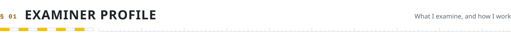</picture>

<picture><source media="(prefers-color-scheme: dark)" srcset="assets/dossier-dark.svg">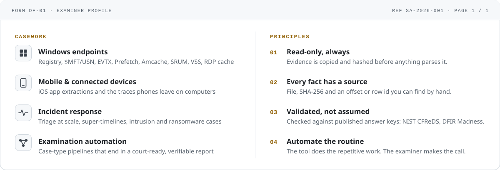</picture>

 

<picture><source media="(prefers-color-scheme: dark)" srcset="assets/section-locker-dark.svg">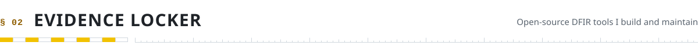</picture>

<a href="https://github.com/sujayadkesar/windows-forensic-automation"><picture><source media="(prefers-color-scheme: dark)" srcset="assets/exhibit-windows-forensic-automation-dark.svg">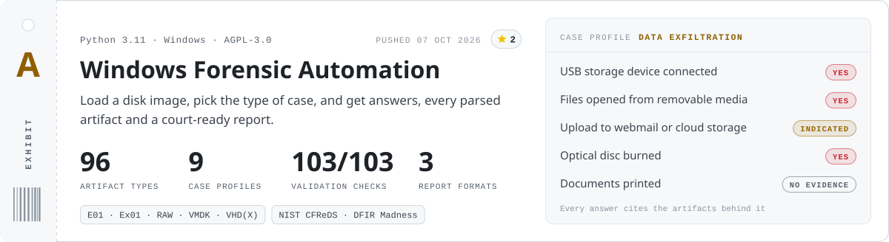</picture></a>

<a href="https://github.com/sujayadkesar/connected-phone-forensics"><picture><source media="(prefers-color-scheme: dark)" srcset="assets/exhibit-connected-phone-forensics-dark.svg">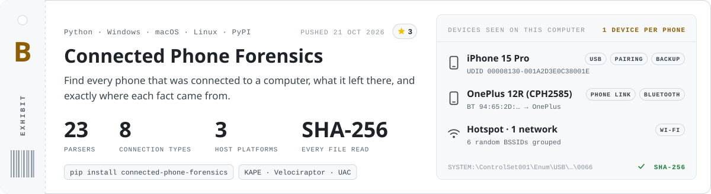</picture></a>

  <a href="https://github.com/sujayadkesar/PhonePe-Forensics"><picture><source media="(prefers-color-scheme: dark)" srcset="assets/exhibit-phonepe-forensics-dark.svg">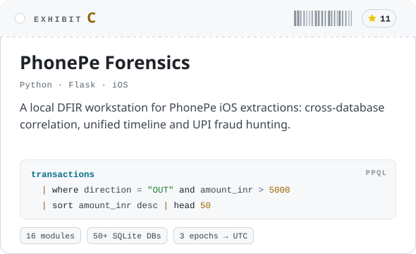</picture></a>
  <a href="https://github.com/sujayadkesar/vscexplorer"><picture><source media="(prefers-color-scheme: dark)" srcset="assets/exhibit-vscexplorer-dark.svg">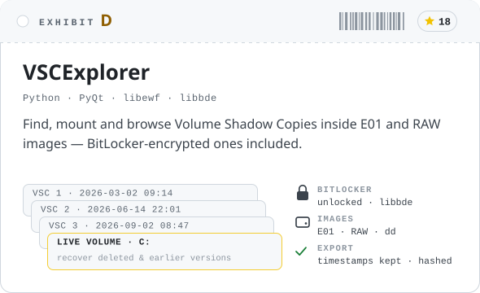</picture></a>

  <a href="https://github.com/sujayadkesar/IR-Agent-Builder"><picture><source media="(prefers-color-scheme: dark)" srcset="assets/exhibit-ir-agent-builder-dark.svg">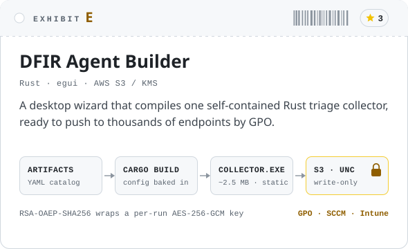</picture></a>
  <a href="https://github.com/sujayadkesar/Autopilot"><picture><source media="(prefers-color-scheme: dark)" srcset="assets/exhibit-autopilot-dark.svg">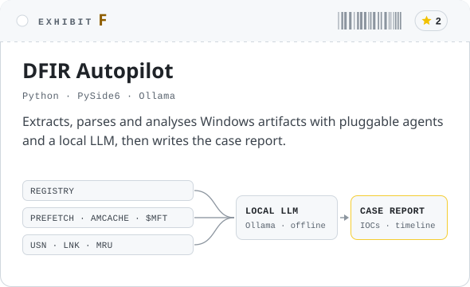</picture></a>

<b>More from the locker</b>

 

<!-- LOCKER:START -->
| Exhibit | What it does | ★ |
|:--|:--|--:|
| [**FAEP**](https://github.com/sujayadkesar/FAEP) | One-click artifact extraction and parsing from E01 images (RegRipper, EZ Tools, Hindsight) | 1 |
| [**RDP-BitmapCache_Parser**](https://github.com/sujayadkesar/RDP-BitmapCache_Parser) | Rebuilds on-screen imagery from RDP bitmap cache files | 1 |
| [**ForensicVault**](https://github.com/sujayadkesar/ForensicVault) | Rapid artifact acquisition from a USB drive | 0 |
| [**cybersecurity-resources**](https://github.com/sujayadkesar/cybersecurity-resources) | Curated cybersecurity learning resources | 327 |
| [**Linux-Privilege-Escalation**](https://github.com/sujayadkesar/Linux-Privilege-Escalation) | Linux privilege escalation, from kernel exploits to cron jobs | 61 |
| [**web-dork**](https://github.com/sujayadkesar/web-dork) | Google dorks for web-app recon and bug bounty | 4 |
| [**reverse-shell-generator**](https://github.com/sujayadkesar/reverse-shell-generator) | Reverse-shell payload generator | 7 |
| [**auto-rec0n**](https://github.com/sujayadkesar/auto-rec0n) | Automates the reconnaissance phase of a penetration test | 9 |
<!-- LOCKER:END -->

 

<picture><source media="(prefers-color-scheme: dark)" srcset="assets/section-kit-dark.svg">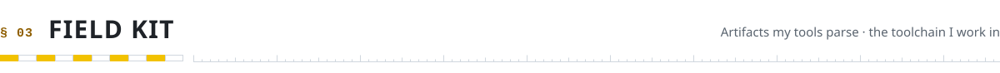</picture>

<picture><source media="(prefers-color-scheme: dark)" srcset="assets/kit-dark.svg">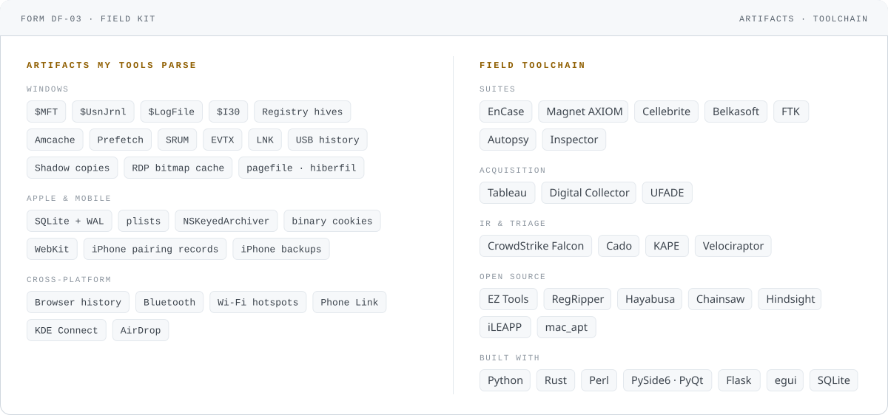</picture>

 

<picture><source media="(prefers-color-scheme: dark)" srcset="assets/section-log-dark.svg"></picture>

<picture><source media="(prefers-color-scheme: dark)" srcset="assets/ledger-dark.svg">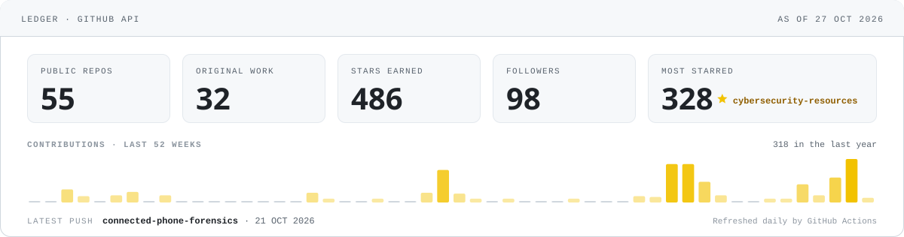</picture>

**Field notes** · from [thelocalh0st.com](https://thelocalh0st.com)

<!-- NOTES:START -->
| Date | Field note |
|:--|:--|
| 2026-10-23 | [One Reported Email, Two Payloads: A SOC Analyst's Email Forensics Playbook](https://thelocalh0st.com/posts/email-forensics-soc-playbook/) |
| 2026-10-22 | [The Browser Kept a Receipt: Proving a Download Was the Same File with ETag](https://thelocalh0st.com/posts/etag-download-forensics/) |
| 2026-10-17 | [Where Is This Access Point? Geolocating a WiFi BSSID, the Forensic Way](https://thelocalh0st.com/posts/wifi-geolocation-forensics/) |
| 2026-10-16 | [Where Was This Laptop? Device Geolocation Hiding in WebCacheV01.dat](https://thelocalh0st.com/posts/webcache-geolocation/) |
| 2026-07-17 | [Prefetch Alternate Data Stream How Malware Hides Execution](https://thelocalh0st.com/posts/guest-in-prefetch-directory/) |
<!-- NOTES:END -->

 

<picture><source media="(prefers-color-scheme: dark)" srcset="assets/seal-dark.svg"></picture>

  Got an artifact your tools can't read? Open an issue on any repo, or find me on <a href="https://www.linkedin.com/in/sujay-adkesar-a90725224/">LinkedIn</a>.
    
  

